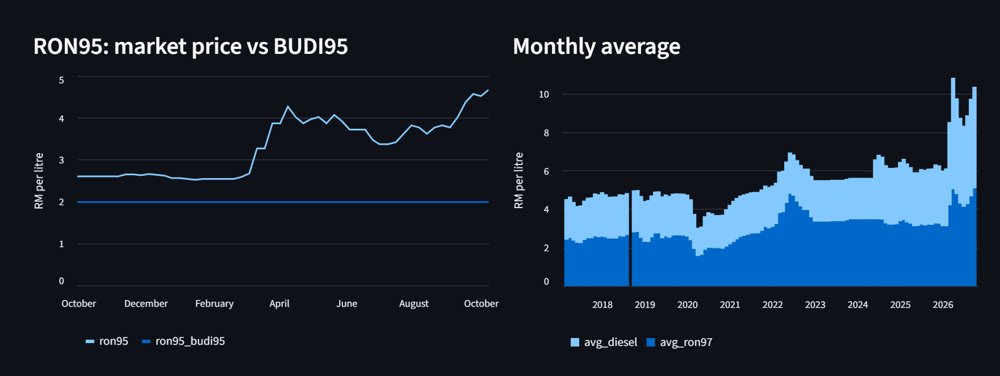
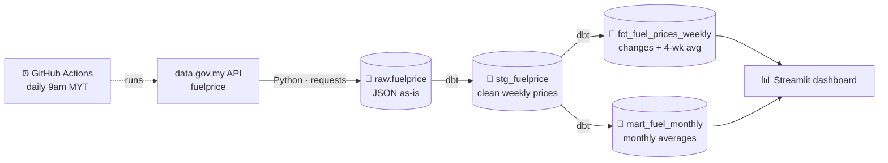

# ⛽ Malaysia Open Data Pipeline

**An automated pipeline that collects Malaysia's official weekly fuel prices from data.gov.my, models them with dbt, and serves a live dashboard, refreshed every day.**


**📊 Live dashboard:** [malaysia-fuel-prices.streamlit.app](https://malaysia-fuel-prices.streamlit.app/)



---

## Why I built this

Fuel prices in Malaysia change every week, and since BUDI95 there's a big gap between the market RON95 price and the subsidised one. I wanted a small, end-to-end project that works like a real data team's pipeline: pull from an official API, keep the raw data, clean it in layers, test it, run it on a schedule, and put the result in front of people.

## Architecture



| Layer | Where | What it holds |
|---|---|---|
| 🥉 Bronze | `raw.fuelprice` | Every API record stored untouched as JSON (both the weekly price and the weekly-change rows) |
| 🥈 Silver | `analytics_staging.stg_fuelprice` | One clean row per week: RON95, BUDI95, RON97, diesel, East Malaysia diesel, as typed numbers |
| 🥇 Gold | `analytics_marts.fct_fuel_prices_weekly` | Week-on-week change and a 4-week moving average |
| 🥇 Gold | `analytics_marts.mart_fuel_monthly` | Monthly averages and monthly price range, for the dashboard |

## What the dashboard shows

- **This week's prices** for RON95 (market), RON95 (BUDI95), RON97 and diesel, with the change from last week
- **Weekly price trend**, switchable between the last year, the last 3 years and all history
- **RON95 market price vs BUDI95**, showing the size of the subsidy gap per litre
- **Monthly averages** for RON97 and diesel
- **The latest 10 weeks** as a table with week-on-week changes

## How it works

1. **Extract & load** (`ingest/extract_load.py`): calls the data.gov.my Data Catalogue API, retries politely on rate limits (the API allows 4 requests a minute), and **upserts** into Postgres, so re-running never creates duplicates.
2. **Transform** (`dbt/`): dbt turns the raw JSON into clean staging and mart models, built in dependency order.
3. **Test**: dbt checks that every week appears once (`unique`) and that no date or RON97 price is missing (`not_null`). If the source data ever changes shape, the run fails loudly instead of quietly serving wrong numbers.
4. **Schedule** (`.github/workflows/pipeline.yml`): GitHub Actions runs extract, load, transform and test every day at 9am Malaysia time. Credentials live in encrypted repository secrets, never in the code.
5. **Serve** (`dashboard/app.py`): a Streamlit app reads the Gold tables through a **read-only database user** and is hosted free on Streamlit Community Cloud. Query results are cached for an hour, so the database isn't hit on every click.

## Repo structure

```
Malaysia-Open-Data-Pipeline/
├── ingest/
│   └── extract_load.py             # API → raw.fuelprice (upsert)
├── dbt/
│   ├── dbt_project.yml
│   ├── profiles.yml                # reads credentials from environment variables
│   └── models/
│       ├── sources.yml
│       ├── staging/
│       │   ├── stg_fuelprice.sql
│       │   └── schema.yml          # data tests
│       └── marts/
│           ├── fct_fuel_prices_weekly.sql
│           └── mart_fuel_monthly.sql
├── dashboard/
│   ├── app.py                      # Streamlit dashboard
│   └── requirements.txt
├── .github/workflows/pipeline.yml  # daily schedule
├── docs/dashboard.png
├── .env.example
└── requirements.txt
```

## Run it yourself

1. Create a free [Supabase](https://supabase.com) project and copy its **Session pooler** connection details.
2. Copy `.env.example` to `.env` and fill in your details.
3. Run the pipeline:
```powershell
   python -m venv .venv
   .venv\Scripts\activate
   pip install -r requirements.txt
   python ingest/extract_load.py
   Get-Content .env | ForEach-Object { $n, $v = $_ -split '=', 2; Set-Item "env:$n" $v }
   dbt build --project-dir dbt --profiles-dir dbt
```
4. Open the dashboard locally:
```powershell
   pip install -r dashboard/requirements.txt
   streamlit run dashboard/app.py
```
5. To automate it, add `PGHOST`, `PGPORT`, `PGUSER` and `PGPASSWORD` as GitHub Actions secrets.

## What I learned

- **Keep raw data untouched.** Storing the API response as-is in Bronze meant I could change my cleaning logic later without calling the API again.
- **Make loads repeatable.** Upserting on `(date, series_type)` means the daily job can run any number of times without duplicating rows.
- **Test the data, not just the code.** dbt tests catch problems in the source data before they reach the dashboard.
- **Give each part only the access it needs.** The pipeline writes with one login; the dashboard reads with a separate read-only one.

## What I'd add next

- **A second dataset**, such as consumer price inflation (CPI) from OpenDOSM, to see whether fuel price changes show up in the cost of living.
- **Incremental loading**, so each run only fetches new weeks instead of the full history.
- **Freshness alerts**, so the pipeline warns me if data.gov.my stops publishing new weeks.

---

<sub>Data: <a href="https://data.gov.my">data.gov.my</a> (Government of Malaysia open data) · Built by <a href="https://bellaazharr.github.io">Ain Nurnabila</a></sub>
